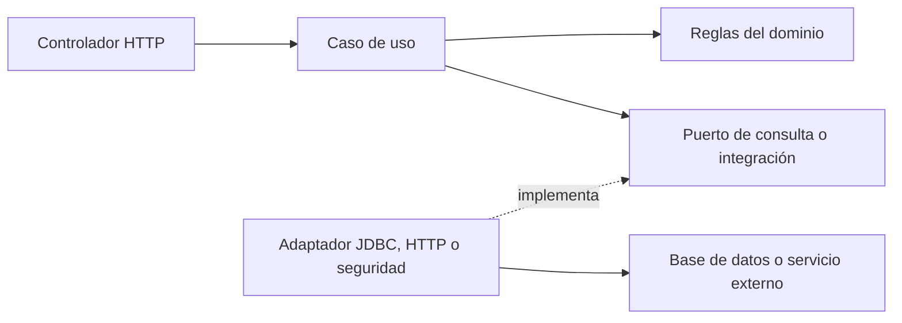

# Arquitectura y mantenimiento

El repositorio contiene tres aplicaciones: backend Java, frontend Next.js y agente Python. La organización es por funcionalidad; cada módulo mantiene sus reglas y expone contratos para colaborar con los demás.

## Backend

El recorrido de informes mantiene estas responsabilidades:



- `web`: recibe parámetros, aplica autorización HTTP y presenta la respuesta. `CandidateInterviewReportsController` depende de un caso de uso; no ejecuta SQL ni genera informes.
- `application`: coordina permisos, consultas y resultados. `CandidateInterviewReportsService` comprueba la empresa y la postulación antes de recuperar evidencia.
- `application/port`: define los contratos de consulta, evaluación, audio, grabación e integración con IA. Los casos de uso no hacen conversiones a `RealAiInterviewerClient`.
- `domain`: contiene modelos y reglas. La validación de puntajes pertenece a `InterviewScore`.
- `infrastructure`: implementa persistencia e integraciones. `JdbcInterviewReportQueries` y `InterviewEvaluationStore` contienen las consultas de informes; el cliente HTTP implementa `AiInterviewerClient`.

La identidad del solicitante se obtiene mediante `CurrentActorPort`. El adaptador `SecurityContextCurrentActor` traduce Spring Security a ese contrato. Las políticas de acceso al CV y a los informes no consultan directamente el contexto de seguridad ni ejecutan SQL.

La elección del entrevistador usa `CompanyInterviewSettingsPort`, sin acceder a entidades JPA desde la aplicación de entrevistas. Los recordatorios escriben mediante `NotificationWriter`; la persistencia garantiza la deduplicación por evento.

## Frontend

```text
InterviewReportsPanel
  └─ useCandidateInterviewReports
       ├─ candidateDrawerApi.getInterviewReports
       └─ downloadInterviewReportPdf
            ├─ contenido del informe
            ├─ reportValues: normalización de valores
            └─ apaReportWriter: diseño, gráficos y paginación
```

El componente presenta estados y acciones. El hook gestiona consultas y descargas. La capa `api` conoce los endpoints. La generación del documento mantiene separado el contenido de las operaciones de dibujo y del formato APA.

No se deben introducir consultas HTTP dentro del escritor PDF ni reconstruir resultados ficticios para completar datos ausentes.

## Agente Python

- `practical_voice/router.py`: transporte HTTP y WebSocket, sesiones activas y conversación.
- `practical_voice/completion.py`: finalización idempotente, composición de la evaluación y conservación de evidencia. Recibe el evaluador y la escritura de sesión como dependencias.
- `practical_voice/autonomous_agent.py`: interacción con IA y análisis de evidencia.
- `theory_interview/final_report.py`: síntesis teórica basada en las respuestas guardadas.
- `shared/session_orchestrator.py`: almacenamiento y recuperación de las sesiones.

El PDF empresarial es la presentación compartida de los resultados persistidos. Se retiró la plantilla HTML antigua del router práctico para evitar mantener dos informes distintos.

## Criterios para nuevos cambios

1. Mantener las reglas de negocio fuera de controladores y componentes visuales.
2. Introducir un puerto cuando un caso de uso necesite persistencia o un servicio externo; implementar el detalle en infraestructura.
3. Preservar los contratos HTTP al reorganizar código. Cambiar comportamiento requiere pruebas específicas.
4. Probar autorización antes de leer evidencia sensible y conservar la idempotencia de las finalizaciones.
5. Mantener resultados de validación, cachés, dependencias y secretos fuera del control de versiones.

`ArchitectureBoundariesTest` comprueba las dependencias directas de los servicios reorganizados. Las pruebas de CV, informes y entrevistas verifican su comportamiento. Es una protección concreta de estos módulos, no una certificación automática de todos los módulos históricos del repositorio.

Los directorios `target`, `.next`, `node_modules`, `__pycache__`, `.artifacts` y `evidencias-hallazgos` contienen resultados generados y se excluyen mediante `.gitignore`. Los scripts reproducibles permanecen en `scripts/`.

Para compilar el frontend cuando está abierto el servidor de desarrollo, usar la construcción de Docker: su contexto aislado evita compartir la caché `.next` del servidor local.
